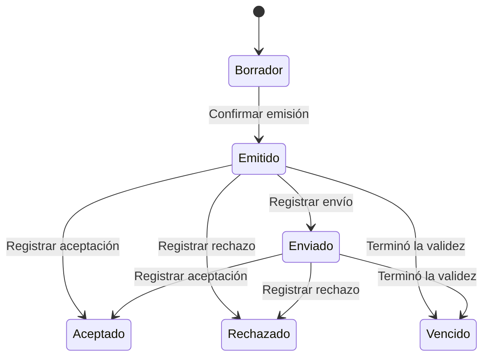

# PRE-03 · Ciclo de vida de presupuestos

La base `de82ec6984373090ef56e0e15fb3874ab90869e5` incorpora VAL-03. Antes, el formulario de alta y el de borradores permitían elegir un estado y el aviso de vencimiento se calculaba por fecha. Los presupuestos cerrados también podían cambiar entre estados sin distinguir el paso anterior. PRE-03 introduce una acción de emisión independiente y transiciones validadas en el servidor.



| Estado guardado | Acciones disponibles | Vencimiento automático |
| --- | --- | --- |
| Borrador | Guardar cambios o emitir con fecha de hoy o posterior | — |
| Emitido | Registrar envío, aceptación o rechazo | Vencido |
| Enviado | Registrar aceptación o rechazo | Vencido |
| Aceptado, Rechazado, Vencido | Consultar o descargar | — |

La emisión asigna el número solo al crear, valida las asociaciones del propietario y conserva una copia del cliente, los materiales y los planes cotizados. El total y el detalle usan los mismos planes validados. Un borrador conserva su edición y el cálculo dinámico. Si ya tenía fecha vencida, puede guardarla al editar otros datos. Para emitir debe corregir la vigencia y puede conservar sus notas históricas intactas.

Un POST sin acción guarda un borrador, incluido el envío legado con un único `estado=borrador` y sin acción explícita. Los demás intentos de asignar estado desde ese formulario, las acciones duplicadas o las desconocidas se rechazan. El formulario de edición remite la revisión del borrador y la emisión de un borrador existente exige una revisión vigente. Las transiciones posteriores requieren el estado de origen, se validan contra el registro bloqueado y solo actualizan el estado y la fecha de actualización. El estado final no puede cambiar desde un formulario obsoleto. Corregir una decisión humana registrada por error requeriría un flujo de auditoría independiente.

La migración `0011_presupuesto_estado_emitido` actualiza las opciones del campo. Mantiene Borrador como valor predeterminado y no reescribe datos. Los presupuestos históricos conservan los códigos que ya tenían, los datos cotizados y los PDF archivados. La emisión, el registro de envío y la descarga son acciones distintas. Obtener un PDF calcula la etiqueta efectiva en memoria y preserva los PDF históricos archivados byte por byte.

## Sincronización y concurrencia

La fecha comercial se obtiene con `America/Santiago`. Una cotización emitida o enviada se puede vencer solo si su fecha de validez es estrictamente anterior a hoy. Por ejemplo, la validez del 30 de noviembre incluye todo ese día en Chile.

Al consultar el listado, Django sincroniza los vencimientos del usuario autenticado antes de aplicar los filtros. Al abrir el detalle o editar, la operación queda acotada al presupuesto propio solicitado. Antes de registrar una transición, Django comprueba la fecha después de bloquear la fila. Estas sincronizaciones pueden ocurrir en GET, pero solo escriben la columna `estado`. El exportador consulta el estado efectivo sin persistirlo. La auditoría de Clientes, Proyectos y Estadísticas no encontró listados ni agregados de presupuestos por estado. Los indicadores económicos existentes del módulo consultan sus propios datos y son independientes del estado de cada cotización.

La emisión y la edición se ejecutan en una transacción. El alta bloquea al propietario para preservar la numeración. La edición bloquea el presupuesto y verifica su revisión antes de emitir. El vencimiento aplica un único `UPDATE` condicional por conjunto. PostgreSQL vuelve a evaluar el estado y la fecha tras esperar un bloqueo. Si otra transacción ya registró una aceptación o un rechazo, la cotización deja de ser elegible. La operación respeta los estados finales y es idempotente.

Se puede ejecutar el comando desde `cut/`:

```bash
python manage.py actualizar_presupuestos_vencidos --dry-run
python manage.py actualizar_presupuestos_vencidos
```

La simulación cuenta los registros elegibles y la segunda forma actualiza los de todos los propietarios. Sin un proceso programado, la persistencia depende de que se consulte la aplicación o se ejecute el comando. Puede haber presupuestos pendientes de sincronizar después de medianoche si nadie entra. El PDF sigue mostrando el estado efectivo de los documentos que genera de nuevo. Los PDF archivados conservan la etiqueta que tenían cuando se crearon.

El servicio `services/presupuestos.py` expone `fecha_comercial`, `estado_efectivo` y `presupuestos_por_vencer` para una futura consulta de NOTI-01. El filtro puede combinarse con el propietario y un intervalo de fechas. PRE-03 preserva las notificaciones existentes de alta.

## Archivos

| Grupo | Cambios |
| --- | --- |
| `models.py` y `migrations/0011_presupuesto_estado_emitido.py` | Opción Emitido y reutilización del detalle cotizado. |
| `services/presupuestos.py` y `management/commands/actualizar_presupuestos_vencidos.py` | Vencimiento, transiciones, fecha comercial y simulación. |
| `forms/budgets.py` y `views/budgets.py` | Validación de acciones y revisiones, operaciones por propietario y guardado transaccional. |
| `exports/pdf.py` | Etiqueta efectiva para PDF generado bajo demanda. |
| Vistas HTML de presupuestos e inclusiones | Confirmación nativa de emisión, filtro, etiquetas y acciones por estado. El tutorial del módulo describe las acciones nuevas. |
| Pruebas Django y Playwright | Casos PRE-03, concurrencia, migración histórica y regresiones ajustadas al contrato nuevo. |

Las pruebas de regresión que antes enviaban `estado=enviado` para cerrar un borrador ahora usan la acción explícita de emisión. Se mantienen las verificaciones de fecha, escritura parcial, permisos, notas históricas y PDF. Las pruebas de transición de un presupuesto vencido ahora verifican que se rechace la aceptación. El ensayo de migración compara todos los campos de registros sintéticos de los cinco estados anteriores, incluidos notas, PDF y asociaciones.

## Verificación local

Desde `cut/` se ejecutaron `python manage.py test --noinput -v 2`, `python manage.py check`, `python manage.py makemigrations --check --dry-run` y `python manage.py migrate --plan`. La migración se aplicó con `python manage.py migrate --noinput` en PostgreSQL y SQLite locales vacíos. Desde la raíz se ejecutaron `git ls-files '*.test.cjs' '*.test.mjs' -z | xargs -0 node --test` y `git diff --check`.

Para reproducir el navegador, migrar una SQLite vacía en desarrollo, cargar `fixtures-ciclo-presupuestos.py` mediante `python cut/manage.py shell` y servirla en loopback con `runserver --noreload --nothreading`. Configurar `CUTLESS_TEST_FIXTURE`, `CUTLESS_TEST_ORIGIN`, `CUTLESS_TEST_BOOTSTRAP` y `CUTLESS_TEST_BOOTSTRAP_JS`. Ejecutar `node cut/cutless/tests/browser/ciclo-presupuestos.cjs`. Si se usa Chromium del sistema, definir `CUTLESS_TEST_CHROMIUM`. El recorrido usa un indicador económico simulado y permite guardar capturas sintéticas con `CUTLESS_TEST_EVIDENCE`.

| Comprobación | Resultado |
| --- | --- |
| Django completo con PostgreSQL 16.16 | 558 aprobadas, 0 fallidas, 0 omitidas. Incluye dos emisiones concurrentes, aceptación frente a vencimiento y migración histórica. |
| Django completo con SQLite 3.50.4 | 548 aprobadas, 0 fallidas, 10 omitidas por requerir `SELECT FOR UPDATE`. Las diez se ejecutaron en PostgreSQL. |
| JavaScript con Node 24.22.1 | 79 aprobadas, 0 fallidas, 0 omitidas. |
| Chromium 156 y Playwright 1.62.1 | Ciclo PRE-03 aprobado a 320, 390, 768 y 1440 px, en temas claro y oscuro y sin JavaScript a 320 px. Regresiones de alta, edición y acciones de gestión verificadas. |
| Comprobaciones de Django y migración | Sin incidencias, cambios pendientes de generar ni migraciones pendientes tras aplicar `0011`. El SQL de `0011` es una operación vacía en ambos motores. |
| `git diff --check` | Sin errores de espacios. |

En Chromium, la casilla de planes de la prueba PRE-01 agotó la espera de estabilidad del clic en la rama y en una copia aislada de `upstream/main`. El recorrido sigue verificando la casilla y el envío, ahora mediante Space y Enter. La regresión PRE-02 agotó la espera del POST por clic en una ronda preliminar y aprobó los cuatro escenarios al enviar con Enter. La primera revisión visual también detectó que una etiqueta de estado ocupaba dos líneas a 768 px. Se conservó una sola línea y se comprobó la geometría de las etiquetas y acciones en la matriz de gestión.

Las capturas locales `pre03-emision-movil.png` y `pre03-emitido-escritorio.png` muestran el error al emitir con una fecha pasada a 390 px y el detalle cerrado a 1440 px. Firefox y WebKit quedaron sin ejecutar porque las descargas de Playwright devolvieron HTTP 403. La prueba móvil usó Chromium con viewport reducido. Safari en iPhone quedó sin verificar.
