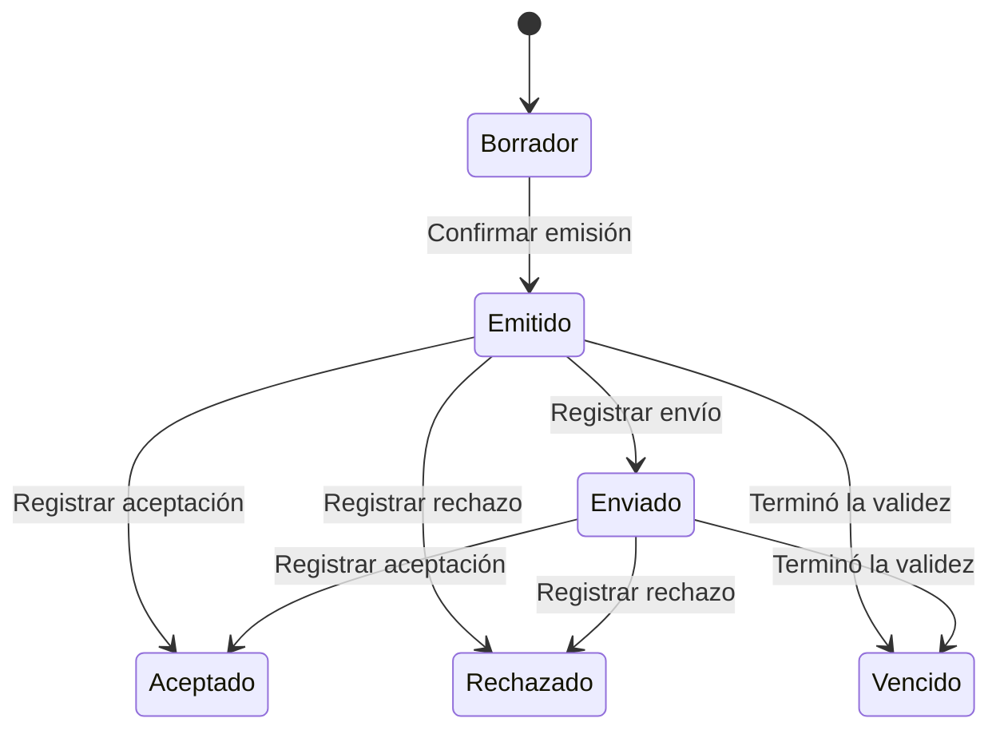

# PRE-03 · Ciclo de vida de presupuestos

La base `de82ec6984373090ef56e0e15fb3874ab90869e5` incorpora VAL-03. Antes, el formulario de alta y el de borradores permitían elegir un estado y el aviso de vencimiento se calculaba por fecha. Los presupuestos cerrados también podían cambiar entre estados sin distinguir el paso anterior. PRE-03 introduce una acción de emisión independiente y transiciones validadas en el servidor.

| Estado guardado | Acciones disponibles | Vencimiento automático |
| --- | --- | --- |
| Borrador | Guardar cambios o emitir con fecha de hoy o posterior | — |
| Emitido | Registrar envío, aceptación o rechazo | Vencido |
| Enviado | Registrar aceptación o rechazo | Vencido |
| Aceptado, Rechazado, Vencido | Consultar o descargar | — |

La emisión asigna el número solo al crear, valida las asociaciones del propietario y conserva una copia del cliente, los materiales y los planes cotizados. El total y el detalle usan los mismos planes validados. Un borrador conserva su edición y el cálculo dinámico. Si ya tenía fecha vencida, puede guardarla al editar otros datos. Para emitir debe corregir la vigencia y puede conservar sus notas históricas intactas.

Un POST sin acción guarda un borrador, incluido el envío legado con un único `estado=borrador` y sin acción explícita. Los demás intentos de asignar estado desde ese formulario, las acciones duplicadas o las desconocidas se rechazan. El formulario de edición remite la revisión del borrador y la emisión de un borrador existente exige una revisión vigente. Las transiciones posteriores requieren el estado de origen, se validan contra el registro bloqueado y solo actualizan el estado y la fecha de actualización. El estado final no puede cambiar desde un formulario obsoleto. Corregir una decisión humana registrada por error requeriría un flujo de auditoría independiente.

La migración `0011_presupuesto_estado_emitido` actualiza las opciones del campo. Mantiene Borrador como valor predeterminado y no reescribe datos. Los presupuestos históricos conservan los códigos que ya tenían, los datos cotizados y los PDF archivados. La emisión, el registro de envío y la descarga son acciones distintas. Obtener un PDF calcula la etiqueta efectiva en memoria y preserva los PDF históricos archivados byte por byte.
