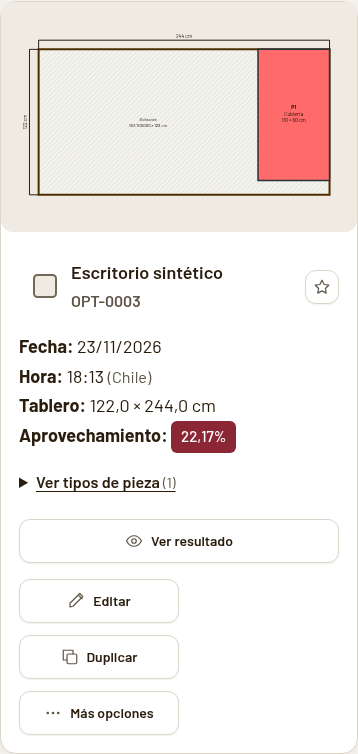
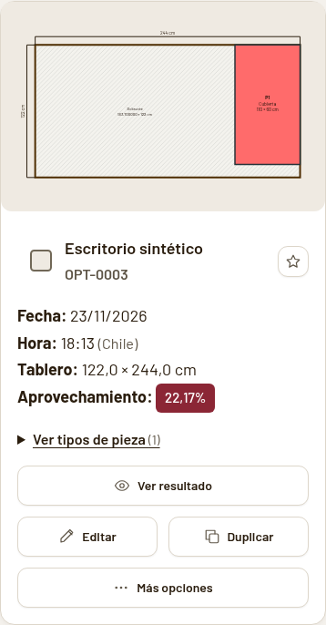
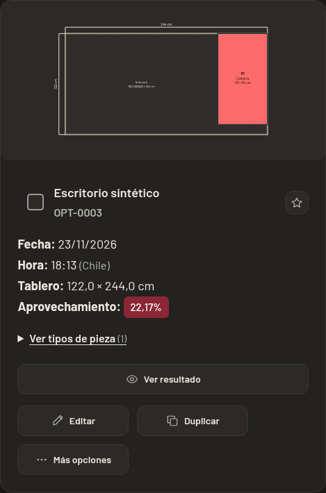
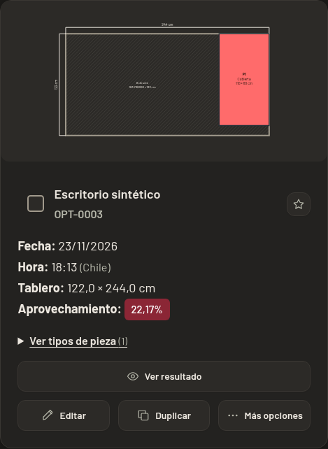

# VIS-04 · Acciones adaptables en Historial

La rama parte de `upstream/main` en `07edb2b5b2ba57a34663837e1343e421bfe65c20`, que ya incluye UX-03 y UX-04. La comparación usa el mismo Historial `/cutless/historial/` con tres planes sintéticos en dos servidores locales. [Fusión de UX-04](https://github.com/gy0kuroo/optimizador_materiales/pull/29)

## Distribución

Antes, «Ver resultado» ocupaba el ancho completo y VIS-02 limitaba las otras acciones a 160 px. Los controles quedaban a la izquierda y pasaban a otra fila cuando tres botones y dos separaciones superaban el ancho de la tarjeta.

- Desde 768 px, «Ver resultado» ocupa toda la primera fila. «Editar», «Duplicar» y «Más opciones» llenan una segunda fila de tres columnas iguales.
- Entre 300 y 767 px, «Editar» y «Duplicar» comparten dos columnas iguales. «Más opciones» ocupa el ancho completo de la tercera fila. Por debajo de 300 px, cada acción tiene su propia fila.
- La cuadrícula conserva la separación de 12 px de VIS-02. Los botones comparten los estilos de CutLess, con un mínimo de 44 px de altura, y las tres acciones secundarias tienen el mismo padding. Cuando una tarjeta de escritorio tiene menos de 26 rem disponibles, el icono pasa encima del texto para que las etiquetas puedan crecer sin superponerse.
- «Más opciones» sigue usando el desplegable de Bootstrap. La lista puede salir de la cuadrícula, admite saltos de línea y conserva las siete acciones. Sin JavaScript, «Editar» y «Duplicar» comparten la segunda fila cuando hay espacio y la lista de enlaces aparece directamente en una fila de ancho completo.

## Capturas comparativas

| Entorno | Antes | Después |
| --- | --- | --- |
| 390 px · claro |  |  |
| 1280 px · oscuro |  |  |

[Menú abierto con foco visible](evidencia/vis04/historial-menu-390.png) · [Enlaces visibles sin JavaScript](evidencia/vis04/historial-sin-js-390.png) · [Zoom de Chromium al 125 %](evidencia/vis04/historial-zoom-390.png)

## Medidas en Chromium 156

Dimensiones en píxeles CSS, medidas con `getBoundingClientRect()` al 100 %. Los dos temas dieron las mismas medidas en los cuatro anchos principales. La prueba comprueba la distribución de las tres tarjetas, una separación de 12 px entre controles, el centrado y la ausencia de desbordamiento horizontal.

| Ancho | Ver resultado | Editar | Duplicar | Más opciones |
| --- | ---: | ---: | ---: | ---: |
| 320 px | 250 × 44 | 119 × 44 | 119 × 44 | 250 × 44 |
| 390 px | 320 × 44 | 154 × 44 | 154 × 44 | 320 × 44 |
| 768 px | 678 × 44 | 218 × 44 | 218 × 44 | 218 × 44 |
| 1280 px | 418,59 × 44 | 131,53 × 44 | 131,53 × 44 | 131,53 × 44 |

A 280 px se comprobó la columna única con cuatro botones de 210 × 44 px. A 1200 px, la tarjeta más estrecha de escritorio del recorrido mostró tres botones de 119 × 70 px, con los iconos encima de las etiquetas. Al aumentar el texto de 14 a 18 px se conservaron la distribución y la legibilidad a 320, 390, 1200 y 1280 px.

El zoom nativo de Chromium al 125 % se configuró en un perfil temporal y se verificó con `devicePixelRatio`. Los anchos de 320, 390 y 1280 px se recompusieron a 256, 312 y 1024 px CSS, con una, dos y tres columnas respectivamente. El menú se abrió por teclado, todos sus enlaces quedaron al alcance del puntero y `Escape` devolvió el foco al botón.

## Verificación

| Prueba | Resultado |
| --- | --- |
| Chromium · Historial | Cuatro anchos en ambos temas, más 280 y 1200 px. Orden de `Tab`, foco visible, apertura con `Enter`, navegación con flechas y cierre con `Escape`. Se comprobaron también apertura y cierre con clic, `hover` y estado deshabilitado. Los destinos, atributos de las acciones, iconos, tipografía, colores y bordes de los controles coinciden con la base. |
| Chromium · Historial sin JavaScript | A 320, 390 y 1280 px, las siete opciones se muestran en la tarjeta y entran en el orden de tabulación. PDF, Excel y PNG se descargan directamente. |
| Chromium · UX-03 y UX-04 | Descargas reales de PDF, Excel y PNG desde «Más opciones», con tipo, extensión, firma y nombre de descarga. Se comprobó el mensaje de espera de cada formato y la secuencia animada de UX-04 con movimiento normal y estática con movimiento reducido. También pasaron los escenarios de PDF de Presupuestos y las regresiones de UX-03. |
| Chromium · VIS-02 | El resto de los paneles conserva las medidas y los recorridos de gestión. Historial tiene su propia prueba de geometría y sigue incluido en el recorrido de interacción de VIS-02. |
| Django · Historial, permisos, navegación, descargas e identificadores | 56 aprobadas en PostgreSQL local. |
| Django · SQLite | 472 aprobadas, 8 omitidas por requerir bloqueo de filas. |
| Django · PostgreSQL 16.16 local | 480 aprobadas. |
| Node y Worker simulado | 67 pruebas de Node y 8 del Worker aprobadas. |
| Migraciones y formato del diff | `makemigrations --check --dry-run` sin cambios. `git diff --check` limpio. |

La primera ejecución de UX-04 produjo dos capturas de compositor iguales en la comprobación de movimiento normal. La repetición completa confirmó el cambio de fotogramas con movimiento normal y la imagen estática con movimiento reducido.

Para repetir el recorrido principal, carga `fixtures-estadisticas-descargas.py` en una SQLite local vacía y ejecuta `node cut/cutless/tests/browser/historial-acciones.cjs` con la configuración de Chromium y Bootstrap local usada por UX-03. `CUTLESS_TEST_BASE` acepta el segundo servidor local con la revisión anterior, los mismos datos y la misma clave de sesión. `CUTLESS_TEST_EVIDENCE` guarda las capturas. [Prueba de Historial](../cut/cutless/tests/browser/historial-acciones.cjs) · [Configuración y pruebas de descargas](VIS_03_UX_03_ESTADISTICAS_DESCARGAS.md) · [Prueba del indicador UX-04](../cut/cutless/tests/browser/loader-descargas.cjs)
